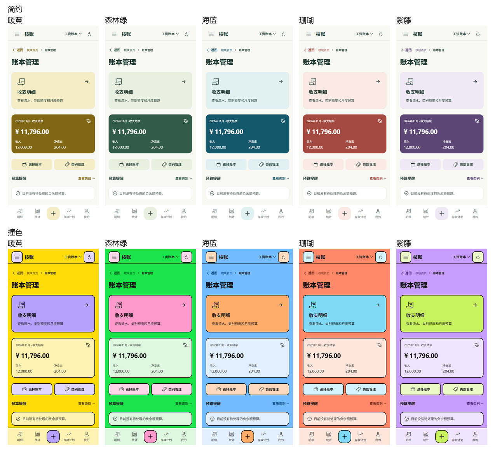
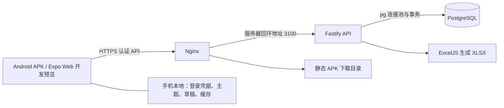

# 枝账（treeCharge）· 个人账本与笔记管理

枝账是一款以 Android 手机为主要使用场景的个人财务管理应用，支持多账本、收支记录、工资分配、月度预算和存款计划。前端使用 Expo／React Native，后端使用 Node.js／Fastify，业务数据统一存储在 PostgreSQL。

目前开发重点为**第一期账本管理**。模块首页保留笔记管理入口，但处于不可点击的待开发状态；Markdown 笔记、文档关联、图片和手机日历集成属于第二期规划。

## 下载与在线服务

| 项目 | 地址 | 说明 |
| --- | --- | --- |
| 源码仓库 | [LichCarlos/treeCharge-monorepo](https://github.com/LichCarlos/treeCharge-monorepo) | 移动端、后端、共享业务包与文档 |
| Android APK | [下载枝账 0.1.20](https://lichcarlos.top/charge-downloads/charge-0.1.20.apk) | versionCode 21，约 40.2 MB |
| 安装包校验 | [构建元数据](https://lichcarlos.top/charge-downloads/charge-0.1.20.release.json) · [SHA-256](https://lichcarlos.top/charge-downloads/charge-0.1.20.apk.sha256) | 用于核对下载文件 |
| 正式 API | <https://lichcarlos.top/charge-api> | App 的后端服务地址，不是网页应用首页 |
| 健康检查 | <https://lichcarlos.top/charge-api/health> | 核验返回 `{"ok":true,"service":"charge-api"}` |

0.1.20 包含简约／撞色两组共十种主题，以及账本首页“金额卡片在上、收支明细入口在下”的调整。安装包沿用原签名，已验证从 0.1.19 覆盖安装并启动；支持 arm64-v8a、x86_64，最低 Android 7.0（API 24）。

SHA-256：

```text
9fadd8c76a18a48182277169cfd9749e52995d68f6c34567cb5615af7feee67f
```

## 功能概览

| 模块 | 当前能力 |
| --- | --- |
| 账号与权限 | 普通用户注册、登录、退出、修改密码、刷新会话；超级管理员管理用户、访问跨用户工作区、控制注册开关并查看审计记录 |
| 账本管理 | 创建、命名、切换和管理多个账本；账本及类别允许同名，通过独立 ID 区分 |
| 快捷记账 | 支出／收入切换、类别选择、四列三排图标分页、金额计算器、日期、备注、按类别选择常用备注；编辑流水直接管理该条记录 |
| 消费类别 | 自定义名称和图标、排序、用途和支出额度；支持同类型账本下批量创建独立同名类别；100 个共享图标可重复绑定 |
| 收支明细 | 收支流水、类别额度、收入明细、月度预算四个同级视图；日期选择、类别筛选、备注／类别／金额模糊搜索；流水按日期升序展示 |
| 工资与预算 | 空白账本默认不使用模板；收支模板仅保留工资分配，支持固定金额、工资百分比、剩余池百分比分配及超支提示 |
| 存款计划 | 自定义目标模板、独立计划卡片、目标金额和进度、手动存入／取出、完整历史及记录编辑删除 |
| 数据统计 | 按所选账本和日期汇总收入、净支出、结余，展示趋势和分类占比，导出真实 `.xlsx` 文件 |
| 删除管理 | 默认软删除，按归属 ID 递归处理子数据；App 提供已删除计划恢复及永久删除，Web 隐藏回收站入口 |
| 个性化与导航 | 简约／撞色各五种主题，全局切换并保存；树形抽屉、面包屑和返回上级；复杂表单逐项填写与总览 |
| 数据扩展 | 提供标签、自定义字段、字段选项、实体关系配置及绑定能力；不能将早期规划中的全部通用配置能力视为已经完成 |



### 核心业务规则

- **归属层级**：用户工作区 → 账本 → 消费类别 → 具体收支记录。账本通过选择／管理入口切换；类别归属具体账本。底层通用实体树支撑该业务层级，当前消费类别不再嵌套子类别。
- **ID 区分实体**：账本、计划、类别和记录使用独立 ID；同名不等于同一对象。多账本批量创建类别时，各账本得到自己的类别 ID。
- **预算与流水分离**：预算额度是计划及参考信息，超支不会阻止真实流水记录；纯收入类别不设置消费额度，各支出类别独立计算。
- **工资是真实收入**：每个工资账本每月一笔工资收入，再次修改工资时更新原流水。工资用于百分比分配计算，各类别额度允许超过工资。
- **超支调剂由用户发起**：类别可显示负余额；用户选择其他有余额类别扣减预算余额进行调剂，保留真实消费流水，不自动伪造收入或支出。
- **存款独立管理**：存款计划有对应账本、类别和存取记录，与日常消费页面分开管理，不代表连接银行自动扣款。
- **递归删除与恢复**：软删除按批次处理所属类别、记录等子数据，恢复不误恢复此前单独删除的数据；已删除计划可永久递归删除，其他同名对象不受影响。

## 前后端构成

项目使用 npm workspaces 管理移动端、服务端和共享业务包。



手机通过 API 读写业务数据，**不直连数据库，也不是全部数据仅存手机的离线应用**。联网服务是最终数据依据；本地缓存用于读取和草稿保留，不提供完整离线写入同步。

| 层 | 技术 | 职责 |
| --- | --- | --- |
| 移动端 | Expo SDK 54、React 19.1、React Native 0.81.5、TypeScript | 页面、导航、表单、快捷记账、主题及状态联动 |
| 本地持久化 | Expo SecureStore、AsyncStorage | 原生登录凭据、主题偏好、编辑草稿、业务读取缓存；Web 会话使用 sessionStorage |
| 图标与图表 | Ionicons、react-native-svg | 统一类别图标、折线与环形图 |
| API | Node.js 22+、Fastify 5、Zod | 输入校验、鉴权、账号／工作区授权、账本／预算／计划与统计接口 |
| 身份认证 | scrypt 密码哈希、随机访问／刷新令牌、数据库会话 | 会话有效期、注销和撤销；不是 JWT 认证方案 |
| 数据层 | PostgreSQL、pg | 通用实体树、业务表、预算函数、软删除批次、事务、审计和迁移 |
| 导出 | ExcelJS | 在服务端生成 XLSX，App 下载后通过系统分享 |
| 部署 | Linux、Nginx、systemd | HTTPS、反向代理、静态下载、API 进程管理与数据库备份 |

后端按业务划分职责，入口由 `server/src/app.ts` 统一注册：

| 文件 | 职责 |
| --- | --- |
| `auth.ts`、`security.ts`、`http.ts` | 注册登录、密码与令牌、鉴权、权限与请求边界 |
| `ledger.ts`、`entities.ts`、`deletion.ts` | 账本／类别／流水／计划、实体归属、软删除与永久删除 |
| `budget.ts`、`budgetCore.ts`、`salaryIncome.ts`、`usage.ts` | 预算分配、工资收入关联、消费占用重算 |
| `configuration.ts` | 标签、自定义字段和实体关系配置 |
| `reports.ts` | 统计与 XLSX 导出 |
| `db.ts` | PostgreSQL 连接池、事务封装及数据库类型处理 |

本地 `compose.yaml` 使用 PostgreSQL 17 镜像；现有服务器文档记录过 PostgreSQL 13 的兼容修复。`pgvector` 镜像的使用不代表当前已实现 AI／向量笔记功能。Termius 用于连接服务器和运维，不承担业务 API 的运行。

### GitHub 仓库组织

推荐使用 **1 个 Monorepo 仓库** 管理整个项目，继续沿用现有 npm workspaces：移动端放在 `apps/mobile`，后端放在 `server`，共享业务规则放在 `packages`，设计与需求文档放在 `docs`。

前后端共同依赖日期、类别规则和模板配置，单仓库能在同一次提交中同步修改与验证，便于个人开发和统一发版。只有团队、访问权限或产品发布节奏需要独立管理时，再考虑拆成移动端、API、共享包三个仓库；当前阶段无需拆分。

源码仓库提交代码、迁移、配置示例和文档；APK 使用服务器下载目录或 GitHub Releases 分发，不提交 `node_modules`、构建缓存、`.work`、环境凭据、数据库备份与签名材料。根目录 `.gitignore` 统一维护这些排除规则。

### 代码目录

```text
charge/
├─ apps/mobile/                  Expo 应用与 Android 工程
│  ├─ App.tsx                    页面编排、模块入口与业务联动
│  ├─ src/
│  │  ├─ api.ts                  请求、会话和服务地址
│  │  ├─ theme.tsx / ui.tsx      全局主题令牌与共享 UI
│  │  ├─ RecordComposer.tsx      记账与记录编辑
│  │  ├─ CategoryManager.tsx     类别字典及图标绑定
│  │  ├─ BudgetEditor.tsx        工资与类别预算编辑
│  │  ├─ budgetStore.mjs         共享预算状态
│  │  └─ SavingsManager.tsx      存款计划与存取记录
│  ├─ android/                   原生构建工程
│  ├─ build-apk.ps1              正式 APK 构建脚本
│  └─ verify-apk.py              发行包内容与完整性检查
├─ server/
│  ├─ src/                       Fastify 路由及业务服务
│  ├─ db/migrations/             001–018 数据库迁移
│  ├─ tests/                     服务端单元与 API 集成测试
│  └─ ops/                       初始化、备份、发布、签名辅助脚本
├─ packages/
│  ├─ calendar/                  前后端共享日期范围与统计周期规则
│  └─ categories/                前后端共享类别规则
├─ src/domain/                   模板配置等领域资源
├─ tests/                        跨端业务计算、缓存、请求等测试
├─ docs/                         需求、设计、交付与检查文档
├─ outputs/                      本地 APK、校验和、发行元数据
├─ compose.yaml                  本地 PostgreSQL
└─ DESIGN.md                     四列网格与全局设计规范
```

## 本地开发

### 环境要求

- Node.js 22 或更新版本，npm。
- Docker／Docker Compose，用于启动本地 PostgreSQL；也可自行提供独立 PostgreSQL 开发库。
- 浏览器可预览 Web；原生 Android 开发和出包另需 Android SDK、JDK 17、NDK 等工具链；包内容验证脚本需 Python 3。

以下命令在项目根目录执行，适用于 Windows PowerShell。

### 1. 安装依赖与初始化数据库

```powershell
npm ci
node server/ops/init-local-env.mjs
docker compose up -d
docker compose ps
```

等待数据库显示 healthy 后执行：

```powershell
npm exec -w server -- tsx --env-file=.env ops/setup-local.mjs
```

环境生成脚本保留已有配置，为新环境生成随机凭据；数据库初始化应用缺失迁移、预备模板并在尚无管理员时创建初始管理员。它只允许 `_development`／`_test` 后缀的数据库。

| 配置 | 用途 |
| --- | --- |
| 根目录 `.env` | 本地 Docker PostgreSQL 初始化凭据 |
| `server/.env` | `HOST`、`PORT`、`PGHOST`、`PGPORT`、`PGDATABASE`、`PGUSER`、`PGPASSWORD` 等 |
| `server/.env.example` | 后端配置示例，不含真实口令 |
| `apps/mobile/.env.example` | 客户端 `EXPO_PUBLIC_API_URL` 配置示例 |

本地数据库默认 `127.0.0.1:15432`，库名 `charge_development`；API 默认端口 `3100`。初始化管理员凭据保存在忽略提交的 `.work/local-admin.credentials.json`，首次登录必须改密。普通用户可自行注册空工作区。

### 2. 启动后端与前端

分别在两个终端执行：

```powershell
# 终端一：后端 API
npm run dev:server
```

```powershell
# 终端二：Expo
npm run dev:mobile
```

Web 开发预览可使用：

```powershell
npm run dev:web
```

访问 <http://localhost:8081>，本地健康检查为 <http://localhost:3100/health>。

| 运行方式 | 开发 API 地址 |
| --- | --- |
| 本机 Web | `http://localhost:3100` |
| Android 模拟器 | `http://10.0.2.2:3100` |
| 局域网手机 | `http://开发电脑的局域网IP:3100`，手机需能访问该电脑 |

可通过登录页的服务地址配置连接开发 API；如设置 `EXPO_PUBLIC_API_URL`，需重新启动 Expo。**正式 APK 禁用明文 HTTP**，连接本地 HTTP 应使用开发构建，不能仅修改正式包内地址绕过平台限制。

### 3. 检查与测试

```powershell
npm run typecheck
npm test
npm run test:api
npm run build -w server
```

`npm test` 包含根目录业务测试与服务端单元测试；`test:api` 需要已初始化的本地数据库和 `server/.env`，使用独立临时测试数据库。不要将集成测试配置指向生产环境。

## Android APK 构建

项目提供 Windows 正式出包脚本，当前机器使用 Android SDK `D:/develop/Android/SDK`，包含 Build Tools 36.0.0、NDK 27.1.12297006、CMake 3.22.1。迁移构建机器时需核对脚本及 SDK 路径。

```powershell
powershell -NoProfile -ExecutionPolicy Bypass -File apps/mobile/build-apk.ps1
python apps/mobile/verify-apk.py outputs/charge-0.1.20.apk
```

输出位置为 `outputs/charge-<expo.version>.apk`。验证脚本生成 `.release.json` 和 `.apk.sha256`，检查正式 API、架构、内嵌 JS、测试入口及私密文件排除。

发布前同步更新 `apps/mobile/app.json`、`apps/mobile/package.json`、根 `package-lock.json` 中的移动端版本，以及 `apps/mobile/android/app/build.gradle` 中的 `versionName`／`versionCode`。覆盖升级必须保留相同应用 ID、签名，并递增 versionCode。

签名材料保存在本机忽略提交的 `.work/android-signing/`，需要单独备份；不应放入文档、源码或安装包。APK 构建不会自动上传公网，也不会自动部署后端。

## 后端部署与维护

现有服务采用 Linux 部署：Nginx 将 `/charge-api/` 转发到 `127.0.0.1:3100`，systemd 运行 `charge-api.service`；PostgreSQL 只供服务器内部访问。APK 下载由 `/charge-downloads/` 映射静态目录 `/opt/charge/downloads/`。

常用目录：

| 目录 | 作用 |
| --- | --- |
| `/opt/charge/releases/<release>/` | 独立后端发行目录 |
| `/opt/charge/current` | 当前服务版本链接 |
| `/etc/charge/database.env`、`/etc/charge/api.env` | 数据库和 API 配置 |
| `/var/backups/charge/` | 数据库备份 |
| `/opt/charge/downloads/` | 对外 APK 文件 |

后端可在本地编译并准备运行目录：

```powershell
npm run build -w server
node server/ops/package-release.mjs .work/backend-release
```

该步骤仅整理运行文件，不执行服务器部署；后续上传、生产依赖锁定、数据库迁移与服务切换按[服务器发布与 APK 交付](docs/服务器发布与APK交付.md)执行。

**现有部署脚本含真实的数据清理规则**：项目所有者此前确认，新后端发行目录首次部署时清空全部用户业务数据、保留账号，脚本先备份并记录发行标识；正常重启及同一发行目录重试不重复清理。执行 `deploy-api.sh` 前必须明确这一行为。仅打包或替换静态 APK 不会触发清库。详见[删除关联与发版数据清理](docs/删除关联与发版数据清理.md)。

服务器维护命令：

```bash
systemctl status charge-api --no-pager
journalctl -u charge-api -n 100 --no-pager
curl --fail https://lichcarlos.top/charge-api/health
bash /opt/charge/server/ops/backup-db.sh
```

数据库口令、SSH 私钥、初始管理员凭据和签名密钥不得公开。正式服务器初始管理员配置位置参见部署文档，不在 README 列出口令。

## 当前边界与后续工作

- **笔记管理为第二期**：尚未实现 Markdown 编辑、双向链接、图片附件和手机日历推送。
- **离线能力有限**：保留草稿及读取缓存，未实现完整离线新增／冲突合并同步。
- **配置扩展仍需完善**：个人模板库、跨账本迁移、部分高级字段／关系编辑、应用内完整备份恢复未全部完成。早期需求和排期文档描述的是目标范围，应以当前实现为准。
- **Web 用于开发预览**：与 App 共用代码，回收站相关入口按平台区分；没有将其另列为已上线的生产 Web 站点。
- **性能检查有边界**：0.1.20 在模拟器下通过普通操作及 5,000 条流水检查，未复现持续内存泄漏；仍存在缓存无容量限制、搜索重复计算及存款记录未虚拟化等优化项，需要继续真机长时验收。详见[性能检查报告](docs/性能检查-0.1.20.md)。

## 文档导航

| 主题 | 文档 |
| --- | --- |
| 产品与业务 | [项目开发规划书](docs/项目开发规划书.md) · [第一期需求规格](docs/第一期账本管理需求规格.md) |
| 架构与账号 | [PostgreSQL 与部署规格](docs/PostgreSQL与服务器部署规格.md) · [用户注册与超级管理员](docs/用户注册与超级管理员规格.md) |
| 账本与预算 | [账本层级](docs/账本层级调整.md) · [模板精简与统一预算](docs/模板精简与统一预算.md) · [明细四视图](docs/明细四视图与筛选统一.md) |
| 共享体验 | [设计规范](DESIGN.md) · [十种主题](docs/十种主题风格.md) · [逐项表单](docs/复杂表单逐项填写优化.md) · [类别图标](docs/类别图标与分类管理.md) |
| 数据生命周期 | [共享组件与存款计划删除](docs/共享组件与存款计划删除流程.md) · [发版数据清理](docs/删除关联与发版数据清理.md) |
| 交付与质量 | [服务器发布记录](docs/服务器发布与APK交付.md) · [性能检查 0.1.20](docs/性能检查-0.1.20.md) |

README 更新日期：2026-11-06。当前发行版本：0.1.20。
