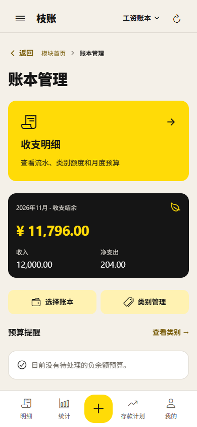
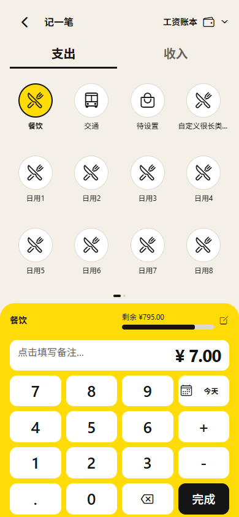
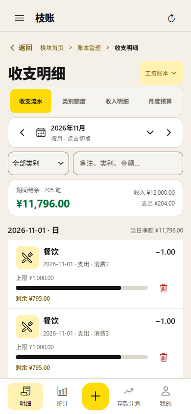

# Units 风格 UI 优化

参考 [Units](https://units.gr/en/homepage)，本次只调整现有 Expo 应用的视觉表现，保持业务功能及填写流程。未升级 SDK，未添加 UI 框架、图标库或字体依赖。

## 视觉方向

采用暖白画布、黑色文字与明亮黄色，替换此前偏灰绿、低饱和的呈现。保留四列网格、16dp 页边距、8dp 栏间距和现有触控尺寸。

| 元素 | 视觉处理 |
| --- | --- |
| 主入口 | 明亮主题色背景、黑色标题、清晰箭头 |
| 收支汇总 | 黑色面板、主题色金额、浅色辅助文字 |
| 普通卡片 | 白色纸面、轻描边、16dp 圆角 |
| 主操作 | 黑底白字，加载、禁用和危险状态沿用共享组件 |
| 当前位置 | 明细标签、底栏、抽屉使用统一主题色选中背景 |
| 记一笔 | 类别选中态统一；白色按键、黑色完成按钮，减少深色边框 |
| 图表 | 黑色趋势线，黄、蓝、橙、绿、紫色分类序列 |
| 主题切换 | 保留五种主题及原有持久化，全局即时更新 |

主题和字号仍集中于 `apps/mobile/src/theme.tsx`，通用卡片、按钮、标题、输入框与选中态由 `ui.tsx` 管理。专项组件只适配自身外观，不复制业务计算。

## 自检与范围控制

- 对照修改前的源码，检查了 463 个事件／值／可访问性属性，以及 222 个状态、API 和持久化调用，均未改变；现有业务文案保持一致。
- 44 项现有逻辑测试通过，覆盖工资分配、超支调剂、计算器、共享状态、图标绑定、表单和超过 200 条记录的筛选。
- TypeScript 检查通过。
- 浏览器检查覆盖 320×568、390×844、480×1040、1440×1000：模块首页、账本管理、四个明细视图、抽屉、日期面板、账本选择、逐项表单、记一笔、备注、统计、存款计划、我的与登录。
- 五种主题分别检查；页面没有横向溢出或浏览器运行错误。
- 主要文字／背景的 34 组 token 配对检查通过，最低对比度 5.24:1；这是一组明确配对的检查结果，不等于所有屏幕像素的自动认证。
- 原有交互回归通过：五种手机尺寸的类别四列三排及横向分页、固定记账面板、备注、筛选、日期同步、单类别额度保存、表单总览／草稿／失败重试。
- Android 隔离验证包构建通过；模拟器覆盖 320×568、360×640／130% 字体，检查抽屉宽度、四个明细视图、真实软键盘下的表单输入与导航、四列三排记账类别及备注输入。
- Web 生产静态导出通过，构建结果位于 `apps/mobile/dist`。验证期间未向线上服务写入账本数据。
- 自检中修复抽屉宽度被 Web flex 布局压缩的问题，仅修改布局样式；同时修复彩色面板上的额度文字对比不足。
- Impeccable 静态检测结果为空；该结果仅代表本次检测器未发现匹配项，不替代实际渲染检查。

## 预览

以下截图使用隔离的界面验证数据，不涉及线上账本写入。

本次以明确层级、稳定网格、可读性和组件一致性作为品质验收依据；奖项本身需要独立评审，不将本次自检表述为获奖认证。
