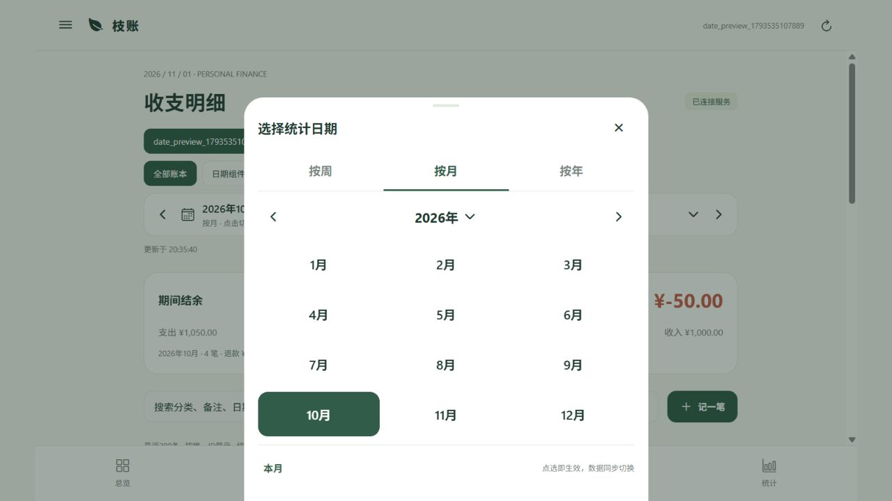
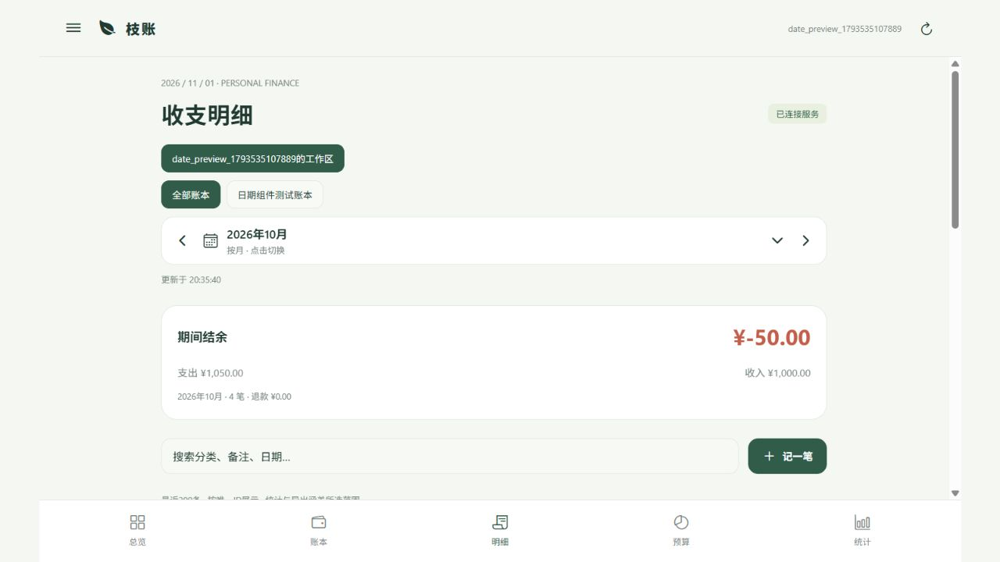

# 全局日期组件与本地联调

更新：2026-11-01。实现于本地 Expo 移动端与 Fastify API，未部署到远程服务器。

## 日期交互

- 点击页面日期入口打开底部面板，顶部提供“按周 / 按月 / 按年”。
- 按月：三列十二个月网格，选中项高亮，左右箭头切换年份；点年份可跳转。
- 按周：周一至周日排列，点击任意一天选择其完整自然周，整行高亮；支持跨月、跨年。
- 按年：十二年网格，左右箭头翻页。
- 提供本周、本月、本年快捷入口；点击选项即关闭并刷新，无额外确认步骤。
- 日期入口两侧可直接切换上一周期和下一周期。总览、明细、预算、计划、统计页面共享所选范围。
- 发生日期、计划日期、确认日期、目标截止日期、自定义日期字段使用同一套日历。实际记账禁选未来日期；计划与目标允许未来日期；非必填日期可清空。
- 模板预算月份使用同一月份网格，提交时转为月份首日。

## 数据口径

明细页直接展示期间收入、支出、退款、结余和笔数；按日期分组，展示当日净额。统计页展示净支出、日均净支出、最高净支出日期、支出笔数、趋势和分类占比。日均按所选完整范围的自然日数计算，趋势补齐无记录日期为0。

日期范围统一使用包含首尾的 `start=YYYY-MM-DD&end=YYYY-MM-DD`；服务端转换为左闭右开查询。保留旧 `month=YYYY-MM` 接口，禁止同时传月份和范围。一次最多366天；所有查询仍进行工作区权限校验。

预算仍为完整月度预算。按周查询时展示相交月份的方案，按年展示全年方案；预算不按天折算。扣额历史跟随这些方案筛选。存钱目标进度为全部历史累计，界面已注明。

Excel实际明细使用同一日期和账本筛选；预算、扣额工作表仅导出相交月度方案，导出说明包含日期范围和预算口径。

切换日期、账本、工作区时清空旧视图并展示加载状态，过期响应不会覆盖新范围。离线缓存按用户、工作区、账本、日期范围分别保存；无对应缓存时不展示其他期间数据。

## 实现入口

| 路径 | 作用 |
| --- | --- |
| `apps/mobile/src/DatePicker.tsx` | 统计周期与单日历、月份输入 |
| `packages/calendar/` | 客户端和服务端共享日期运算 |
| `apps/mobile/src/ui.tsx` | 通用表单集成日期字段 |
| `apps/mobile/App.tsx` | 全局范围、日分组、汇总、导出 |
| `server/src/dates.ts` | API日期范围校验 |
| `server/src/ledger.ts` | 明细、计划、预算范围查询 |
| `server/src/reports.ts` | 汇总、趋势与XLSX筛选 |

## 验证

- `npm test`：20个领域/日期测试、4个服务端单元测试通过。
- `npm run test:api`：真实PG隔离数据库联调通过，包括注册、权限、预算、扣额、存钱、管理员及日期筛选。
- 日期覆盖：闰年2月29日、跨年周、月末翻页、非法日期、反向范围、首尾边界、无记录日补零。
- Excel读取验证：2月导出不含3月1日记录，不含范围外预算。
- 预算一致性验证：先记账后设置预算、原支出修改后的跨月退款、分类映射修订均重新计算使用额；删除的退款可保留关联用于恢复，不阻止原记录随后进入回收站。
- 浏览器实际交互已验证：月切换、整周选择、年度聚合、页面切换保留范围、日历点选回填、未来实际日期禁选。
- Android Hermes资源导出通过；资源导出不等于APK或真机验证。
- APK构建尚未完成：已解决JDK临时目录和Expo字体版本问题；Android NDK 27.1.12297006下载停滞，直接下载官方压缩包返回传输EOF。已停止该次构建，未生成可安装APK。

本地交互使用独立 `date_preview_*` 测试账号和明确标记的测试账单，没有向普通新用户预置流水。

验收截图：

