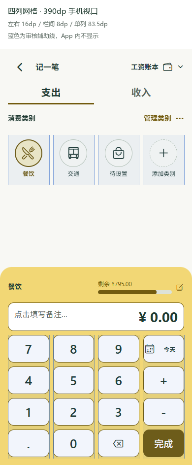

# 四列网格 UI 优化结果

实施日期：2026-11-05。基线：0.1.11；本地交付版本：0.1.12，Android versionCode 13。

本轮把原审核计划落实为共享设计参数和页面改动，保留黄色默认主题、现有五种主题、图标绑定、业务归属与额度计算。实施范围为移动端和 Expo Web，共享样式不改后端数据结构。

## 1. 设计依据与项目约定

《平面中的网格设计》在此作为稳定边界、列宽、间隔、对齐和信息层级的思想依据。未取得指定版本原文，不宣称逐条符合书中标准。四列、16dp、8dp 是本项目冻结的参数。

| 依据 | 本项目落实方式 |
| --- | --- |
| [原四列网格审核计划](移动端四列网格UI审核计划.md) | 手机竖屏四列；左右 16dp；栏间距 8dp；通栏跨四列、双指标各占两列；登记导航和日历例外 |
| [Expo Design System](https://github.com/expo/skills/tree/main/plugins/expo/skills/expo-design-system) | 扩展现有 `theme.tsx`，统一颜色、间距、字号、圆角和布局参数，不建立第二套设计系统 |
| [Impeccable](https://github.com/pbakaus/impeccable) | 沿用现有产品风格，减少重复标题和装饰，突出主任务，按手机尺寸检查实际渲染 |
| [UI UX Pro Max](https://github.com/nextlevelbuilder/ui-ux-pro-max-skill) | 核心操作 48dp 热区、持续显示输入标签、备注键盘避让、文字对比度检查 |
| [Vercel React Native Skills](https://github.com/vercel-labs/agent-skills/tree/main/skills/react-native-skills) | 流水使用 SectionList 虚拟渲染；保持全量查询、日期升序和共享状态；不机械套用新版 SDK 或 iOS API |

四个 Skill 已安装并用于本次实施。项目长期规则保存在 [DESIGN.md](../DESIGN.md)。技能建议是审查依据，不是质量认证。

## 2. 主要改动

| 原问题 | 实施结果 | 对应代码 |
| --- | --- | --- |
| 页面、记录页和弹窗各用不同边距 | 主要容器统一 16dp；类别与金额键盘共享四列宽度公式及 8dp 栏间距 | `theme.tsx`、`grid.mjs`、`ui.tsx` |
| 类别图标网格与记录页密度不同 | 记账类别四列两行横滑；图标库四列、每页 20 个；保留 100 个图标和重复绑定规则 | `CategoryPager.tsx`、`CategoryManager.tsx` |
| 小图标按钮和分页热区偏小 | 共享按钮、抽屉操作、返回、分页及计算器核心操作采用 48dp；类别删除与排序分开 | `ui.tsx`、导航及类别组件 |
| 多处标题、状态信息重复占位 | 明细共用分段控件，搜索与预算在同一操作组；顶部减少重复装饰；压缩明细首屏间距 | `App.tsx` |
| 列表一次挂载全部流水 | SectionList 按天分组、按可见区域渲染；未添加条数截断 | `App.tsx`、`TransactionRow.tsx` |
| 同一条流水有重复编辑操作 | 点击流水主体编辑该条；独立删除按钮；备注和日期最多两行 | `TransactionRow.tsx` |
| 类别额度显示的密度不一致 | 完整额度条展示上限、使用比例、已用和剩余；记账页复用紧凑变体；收入继续不展示额度 | `CategoryAllowanceBar.tsx`、`CategoryDetailsList.tsx` |
| 备注与快捷备注容易抢占类别空间 | 快捷备注仅编辑时展示；完成备注后恢复金额键盘；小屏类别区独立滚动 | `RecordComposer.tsx` |
| 表单依赖占位文字 | 登录/注册增加持续显示的用户名、密码和确认密码标签 | `App.tsx` |
| 个别主题文字偏淡 | 加深黄色和珊瑚色的文字强调色，统一辅助文字及危险色 | `theme.tsx` |

记录页网格标注：蓝色仅为审核辅助线，产品不显示。

## 3. 验证证据

### Web 手机视口

实际 Expo App 连接隔离的模拟 API，数据含 205 条消费及跨月历史收入，未修改生产账号数据。

| 视口 | 内容宽度 | 计算器单列宽度 | 检查结果 |
| --- | --- | --- | --- |
| 320 × 568 | 288dp | 66dp | 无页面横向溢出；计算器保留在视口内 |
| 360 × 640 | 328dp | 76dp | 同上 |
| 390 × 844 | 358dp | 83.5dp | 同上 |
| 412 × 915 | 380dp | 89dp | 同上 |

已验证：滑动可到达第 205 条；默认只挂载可见窗口附近的记录；单类别编辑只显示一个额度输入；保存不修改工资或其他类别；收入无额度条；五种主题全局切换；长名称省略；Web 隐藏恢复入口；备注快捷选择有效；结束备注后计算器位置恢复。运行中未捕获页面脚本异常。

相关脚本和结果保存在 `.work/grid-ui-browser.mjs`、`grid-ui-browser-results.json`、`grid-ui-functional.mjs`、`grid-ui-functional.log`，其中数据均为测试样本。

### 可读性与代码检查

- 五种主题共 34 组正文、主题文字、按钮、辅助文字及错误文字的颜色组合达到至少 4.5:1；这是指定组合的计算检查，不能替代所有图表与系统控件的人工审查。
- 工作区 TypeScript 检查通过；现有 38 项共享逻辑测试与 7 项服务端测试通过，共 45 项。
- Impeccable 静态扫描未报出检测项；此结果仅覆盖扫描器能识别的规则。

### Android 原生

Android 15 小屏模拟器，720 × 1280px、density 320，即 360 × 640dp：

- 顶部操作位于系统安全区域内；页面左右各 32px，换算为 16dp；核心按钮至少 96px，换算为 48dp。
- 通过账本模块首次进入、返回上一级、退回模块首页再进入；搜索可找到第 205 条消费；单类别额度编辑只有一个金额输入。
- 备注在系统键盘上方可见；常用备注选择有效；键盘关闭后金额键盘纵坐标偏差不超过 1dp。
- 100%、130%、200% 系统字号下，金额键盘和完成操作可达；大字体备注支持滚动输入，类别区可单独滚动。
- 类别管理图标、抽屉正常；未捕获 ReactNativeJS 或 AndroidRuntime 错误。

自动化使用独立应用 ID `com.charge.personal.griduiqa`、模拟 API 和本机测试数据。最终代码复验日志为 `.work/grid-ui-native-final.log`。测试入口移出移动端源码，正式 APK 已检查不含测试标记。测试脚本保存在 `.work/grid-ui-native.py`。

原生截图：[记一笔](screenshots/grid-native-record.png)、[备注键盘](screenshots/grid-native-remark-keyboard.png)、[键盘恢复](screenshots/grid-native-remark-restored.png)、[200% 字号](screenshots/grid-native-font-20.png)、[大字体备注](screenshots/grid-native-font-20-keyboard.png)。

## 4. 截图

| 页面 | 证据 |
| --- | --- |
| 账本管理首页 | [360dp](screenshots/grid-home-360.png) |
| 收支明细 | [360dp](screenshots/grid-details-360.png) |
| 类别额度 | [390dp](screenshots/grid-categories-390.png) |
| 单类别额度编辑 | [390dp](screenshots/grid-single-cap-390.png) |
| 记一笔 | [320dp](screenshots/grid-record-320.png)、[390dp](screenshots/grid-record-390.png) |
| 两行类别及长名称 | [390dp](screenshots/grid-record-two-rows-long-name.png) |
| 类别图标库 | [四列图标](screenshots/grid-category-icon-manager.png) |
| 月度预算 | [390dp](screenshots/grid-monthly-budget-390.png) |
| 持续显示登录标签 | [320dp](screenshots/grid-login-320.png) |

## 5. 已知边界

- 本轮为手机竖屏。没有把宽屏最大阅读宽度当成平板专用适配，也未新增暗色模式。
- 底部五个操作位置、日历七列是功能网格例外；小屏日期格宽度可能不足 48dp，不能宣称全部控件均达 48×48dp。
- 系统字号通常正常跟随；固定金额键盘数字和紧凑日期文字放大上限为 1.3，避免挤出关键操作。
- 模拟器不能替代真机。刘海/挖孔、不同输入法、手势导航以及最大字号还需在目标手机补充验收。
- 本次仅构建本地 APK；没有执行生产部署或清理服务器数据。

## 6. 本地安装包

安装包：[charge-0.1.12.apk](../outputs/charge-0.1.12.apk)。接口地址沿用 `https://lichcarlos.top/charge-api`。支持 arm64-v8a、x86_64；沿用现有应用 ID 与签名，用于覆盖安装验证。

发布包核查通过：内嵌业务 JS、HTTPS 接口配置、APK ZIP 完整性、ABI、测试标记排除与敏感文件排除；v2 签名有效，证书与 0.1.11 一致。正式 APK 在模拟器覆盖安装并启动至登录页，无原生运行错误；未登录生产账号或写入业务记录。截图：[正式包登录页](screenshots/android-release-0.1.12-login.png)。

文件大小：40,175,383 字节。SHA-256：`19997fcb53c6cac375c89c4ba55e94cb7994b116405f6693eb40cf3fbe43f710`。哈希与构建元数据保存在安装包旁的 `.sha256`、`.release.json` 文件。
