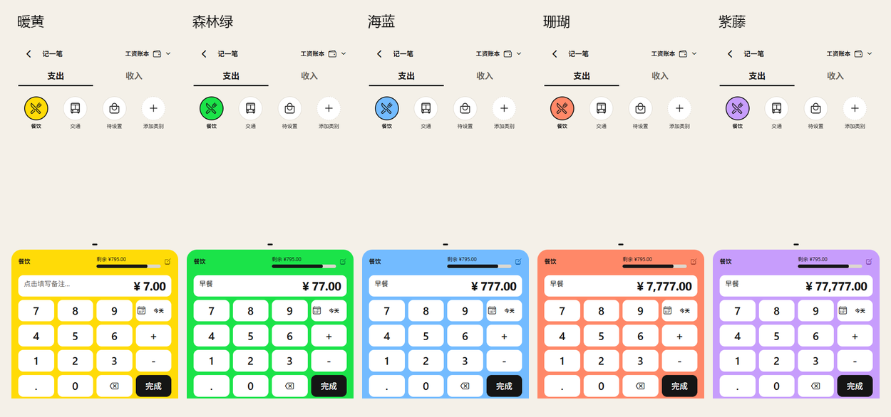

# 多主题复核

2026-11-06 对当前实现进行专项复核。五种主题均已采用 Units 适配后的新配色，不只修改主题选择器的色块。

| 主题 | 主色 | 全局即时切换 | 刷新后保留 |
| --- | --- | --- | --- |
| 暖黄 | `#FFDB07` | 通过 | 通过 |
| 森林绿 | `#1BE349` | 通过 | 通过 |
| 海蓝 | `#73BBFF` | 通过 | 通过 |
| 珊瑚 | `#FF8868` | 通过 | 通过 |
| 紫藤 | `#C79DFC` | 通过 | 通过 |

每种主题检查 14 个界面状态：我的、模块首页、账本首页、抽屉、明细、类别筛选、账本切换、日历、预算表单、记一笔、备注、统计、存款计划、类别编辑。使用隔离的界面数据，未提交业务写入。

复核包含实际 CSS 颜色断言：入口卡片、汇总金额、底部加号、当前导航项、明细标签、账本和类别选中态、计算器、选中图标及类别创建入口；刷新后核对选中的主题与主色。

正文、主要保存按钮和趋势线保持黑色；普通卡片保持白色；收入与危险提示保留固定语义色。这些颜色不随主题改变，是设计规范的一部分。统计分类使用独立配色序列，第一序列跟随主题。

主要文字与背景 34 组 token 配对检查通过，最低对比度 5.24:1。未发现旧灰绿配色残留、全局主题切换遗漏、页面横向溢出或运行错误。本次复核没有修改应用业务代码。

本次专项实测环境为 390×844 的移动端浏览器；Android、窄屏与放大字体的既有验证见《Units 风格 UI 优化》，未将本次复核扩大表述为五种主题的逐一真机认证。

