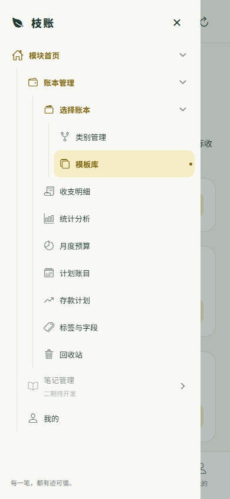
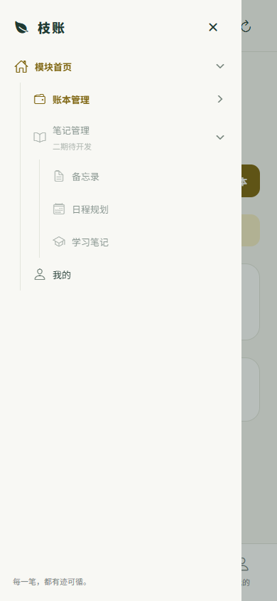

# 树形页面导航

侧边抽屉、页面标题、面包屑与返回上一级均使用 `apps/mobile/src/navigation.ts` 的 `navigationTree`。此处是页面从属关系，与账本 → 消费类别 → 金额记录的数据归属分别管理；抽屉不列出具体账本，实际账本继续在选择账本页面与底部弹窗切换。

```text
模块首页
├─ 账本管理（原首页概览）
│  ├─ 选择账本
│  │  ├─ 类别管理
│  │  └─ 模板库
│  ├─ 收支明细
│  ├─ 统计分析
│  ├─ 月度预算
│  ├─ 计划账目
│  ├─ 存款计划
│  ├─ 标签与字段
│  └─ 回收站
├─ 笔记管理（二期待开发）
│  ├─ 备忘录（待开发）
│  ├─ 日程规划（待开发）
│  └─ 学习笔记（待开发）
├─ 我的
└─ 系统管理（仅超级管理员可见）
```

分支右侧箭头仅控制展开与收起，已开发页面的名称用于跳转。缩进与连接线体现层级，当前页面高亮，上级路径强调显示。打开抽屉时自动展开当前页面的祖先，其余分支保留本次应用运行期间的折叠状态。笔记分支可展开查看规划，页面入口禁用。

`navigationPath()` 从同一棵树推导面包屑和返回目标：类别管理/模板库返回选择账本；我的/系统管理返回模块首页；账本各功能返回账本管理。存款计划详情、按类别筛选的流水在静态路径后追加动态节点，返回先清除详情选择。底部导航保持快捷入口，不改变页面的父子关系。

第二期新增页面时，在 `Page` 类型、页面渲染逻辑中接入实际功能，并为相应笔记节点设置 `page`、移除 `disabled` 与待开发标记；导航、标题、面包屑与返回关系会沿用该节点的位置。`adminOnly` 控制导航可见性，服务端继续负责真实权限验证。

已通过类型检查与390×844移动端浏览器验证：展开/收起、当前页高亮、重开自动展开祖先、模板与类别的父级返回、笔记入口禁用、普通用户隐藏系统管理。




