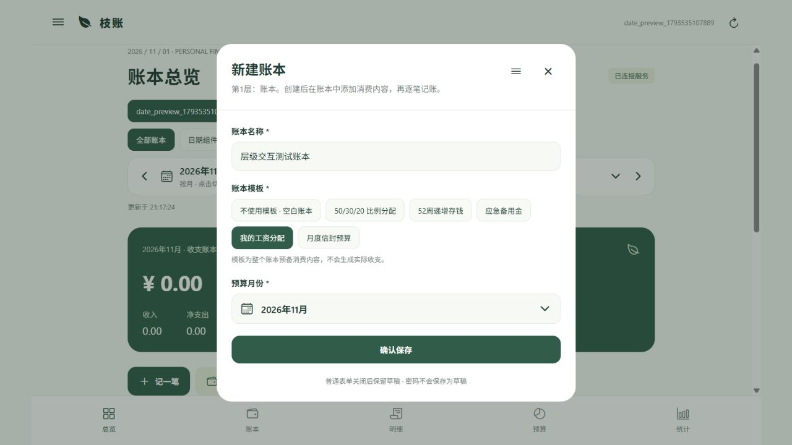
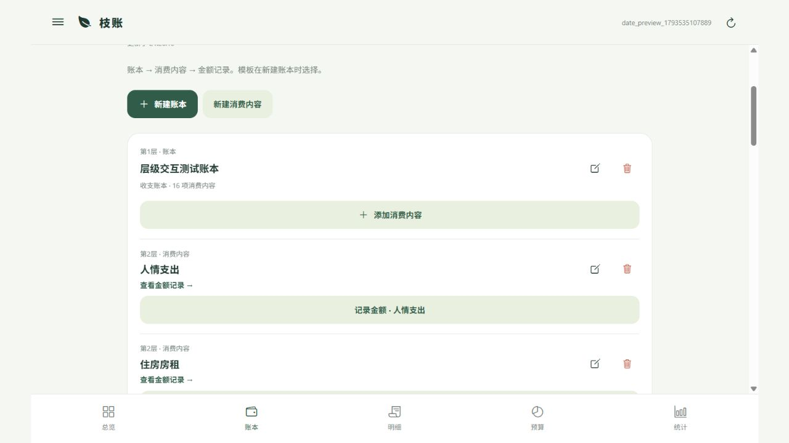
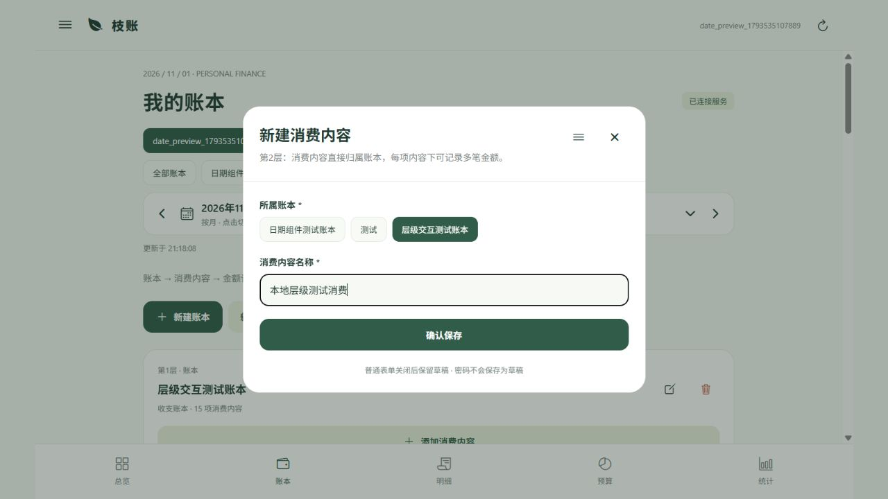
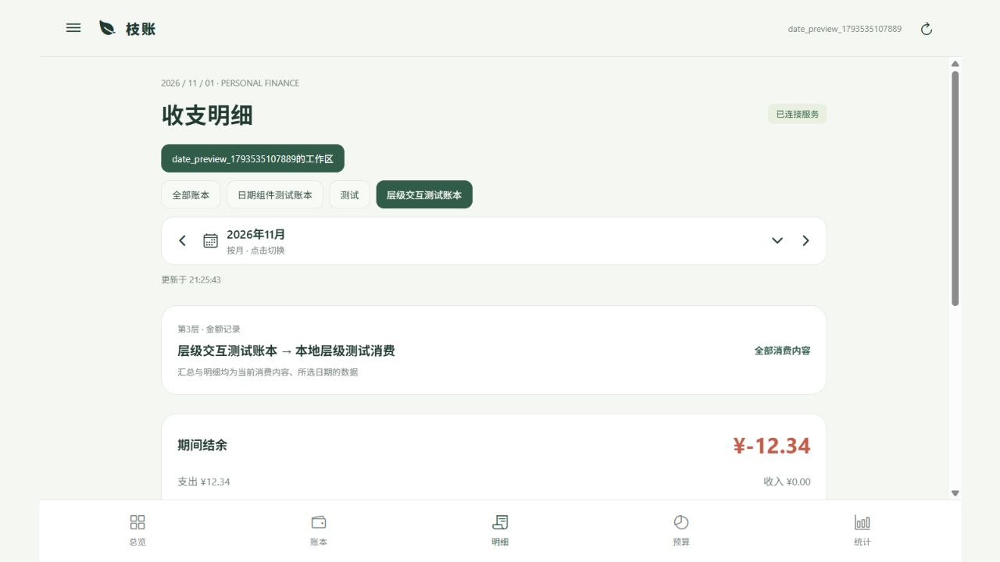

# 账本层级调整

> 2026-11-02交互更新：本篇保留数据结构与迁移记录。日常界面已移除层级标识与嵌套账本卡片，改为首页及专用记录页，见[首页与快捷记账交互](首页与快捷记账交互.md)。

2026-11-01，根据本轮截图与需求，替代早期任意嵌套分类方案。

## 现行业务层级

1. **账本**：例如“我的工资分配”，可为收支账本或存钱账本。
2. **消费内容**：例如通勤交通、日常饮食、住房房租、长期储蓄。直接属于唯一账本，彼此同级，不再有子分类。
3. **金额记录**：一项消费内容对应多笔记录；每笔有金额、方向、日期及可选的一条备注。可追溯唯一消费内容与账本。

辅助标签、自定义字段、附加关系仍可用于查询与扩展，但不会改变账目主层级。工作区、旧分组与备注实体仅为内部存储结构，不作为额外的消费层级展示。

## 移动端交互

- 新建账本填写名称，默认“不使用模板”；也可选择工资分配、比例分配、月度信封、52周存钱、应急备用金模板。
- 模板作用于整个新账本，为它预备消费内容以及预算草稿或存钱目标。模板库“使用此模板”进入同一新建账本表单。
- 工资模板不写入参考工资、参考消费或实际流水，额度由用户后续设置。
- 账本卡片下直接列出消费内容，提供添加、编辑、删除和“记录金额”入口。
- 点击消费内容进入它的金额记录。期间汇总、明细和后端报表按消费内容ID筛选，避免同名内容混淆；返回全部消费内容可恢复整本明细。
- 记账先选账本，再选择该账本下的消费内容；切换账本会清除不匹配的消费内容和方向。存钱账本显示存入/取出，收支账本显示收入/支出/退款。
- 负预算来源扣额、实际流水、全局日期选择逻辑保持原有业务规则。

## 后端与现有数据

- `/categories` 保留兼容路由名称，业务含义为消费内容；`parentId`可省略，后端自动设为账本。提供非本账本的上级会返回422。
- 编辑接口不允许消费内容放到另一个消费内容下，也不支持绕过关联处理直接跨账本移动。
- 所有模板生成的消费内容都是账本的直接子节点。旧模板配置中的children在实例化时作为同级消费内容创建，仍可共同映射到一个预算项。
- `/state`、`/reports`、`/export.xlsx`支持`categoryId`，与`ledgerId`和日期条件同时生效。预算工作表仍展示完整月度方案。
- 新迁移`010_ledger_content_hierarchy.sql`将现有消费内容的parent设为它已有的ledger_id；保留ID、实际流水、备注、模板快照、预算映射与扣额历史。
- 原来因已删除父分类而隐藏的后代消费内容，在打平前转为软删除，防止迁移后意外重新出现；可在回收站分别恢复。
- PostgreSQL延迟约束同时禁止消费内容嵌套，API以外的写入也必须符合层级。

本地开发数据库已应用010；远程数据库未在此次任务中更新。

## 验证

- 真实PG集成测试覆盖旧嵌套数据迁移、流水/备注/预算映射保留、删除状态保留、数据库拒绝嵌套。
- API测试覆盖新增与编辑拒绝子分类、跨账本记录拒绝、五种模板均生成直接消费内容、模板不生成流水。
- 按消费内容ID筛选的明细、汇总和Excel导出一致。
- 独立浏览器测试页验证账本级模板、消费内容创建、指定内容记账和明细跳转。

交互截图：

类型检查、24项单元/领域测试、真实PG集成套件、后端构建和Android Hermes资源导出均通过。此次未生成APK。
