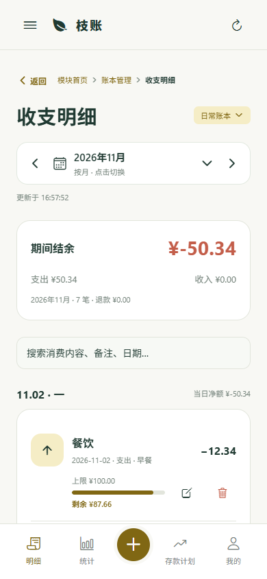
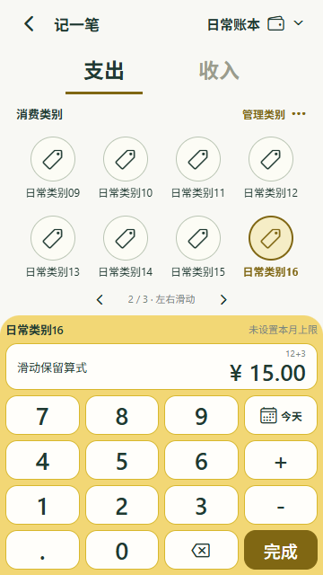
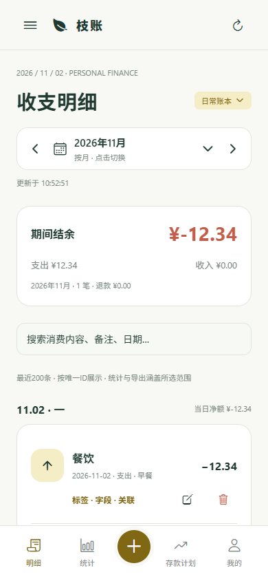
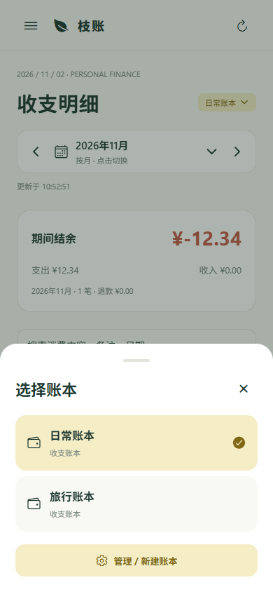

# 首页与快捷记账交互

2026-11-02，根据本轮参考图更新移动端交互。数据归属仍为账本 → 类别 → 金额记录；日常页面不再展示这些层级或嵌套账本卡片。

## 页面与导航

- 模块首页保留账本管理入口，进入后默认到收支明细。首页仍可从抽屉进入，不占底栏位置。
- 底栏为：明细、统计、中央＋、存款计划、我的。＋直接打开日常收支的全屏记录页；明细页面移除重复的“记一笔”按钮。
- 明细、统计页标题右侧显示当前账本名称，替代连接状态，点击打开底部账本切换弹窗；完整的账本列表、新建、模板、重命名与删除集中在“选择账本”页。
- 收支明细完整展示当前账本、所选日期范围内的全部有效记录，不设置200条或其他固定条数截断。移除“最近200条 · 按唯一ID展示 · 统计与导出涵盖所选范围”的说明节点。
- 明细按发生日期升序分组，最早日期在前、最晚日期在后；同一天按创建时间、记录ID稳定升序排列。日期分组使用一次遍历，搜索也覆盖全部已读取记录。
- 统计查询同步取消固定条数上限，汇总与明细使用相同账本、日期和类别筛选。完整流水缓存单独版本化，避免离线时复用旧的200条截断缓存。概览中的“最近记录”仍展示最新五条。
- 记录页右上角可以切换记录所属账本。切换后清空不匹配的类别，保留金额、日期和备注。
- 当前账本按用户及工作区保存，后续优先恢复；原账本被删除时选取仍可用的账本。
- 页面标题上方以“返回＋面包屑”替代日期和英文标语，祖先节点可点击。收支明细等页面回到账本管理；模板库回到选择账本；类别明细回到完整流水；存款计划详情回到计划列表。模块首页不显示返回按钮，Android系统返回键使用同一层级规则。
- 左侧抽屉采用可折叠的树形导航，并与面包屑、返回上一级共用页面定义。类别管理和模板库属于选择账本；我的与系统管理属于模块首页。笔记管理预留独立分支，入口保持禁用，详见[树形页面导航](树形页面导航.md)。

## 类别与计算器

- 日常收支记录提供支出/收入切换；存款计划详情内提供存入/取出，并锁定当前计划的账本。
- 类别固定为每页四列、两行，超过八个入口时左右滑动翻页，底部提供页码和上一页/下一页按钮。添加类别按钮计入分页；新建或恢复已选类别时自动定位其所在页。图标由名称匹配，支持名称未预设的自定义类别。
- 记录页采用固定屏幕布局，类别区域独立横向滑动，不产生整页纵向滚动。计算器与金额输入从进入页面起始终显示，未选类别可先输入金额，保存时校验类别。
- 计算器提供数字、小数点、加减、退格、日期、备注和完成；长按退格清空计算式。类别翻页、收入/支出切换、账本切换均保留金额、日期和备注，屏幕较小时自动缩小图标及间距。
- 消费上限摘要合并到计算器标题行；管理员理由及退款原支出通过“记录信息”弹窗填写，避免额外字段挤压计算器。
- 金额采用整数分计算，例如0.10＋0.20等于0.30，不使用浮点累计或执行表达式代码。
- 完成时只生成一条最终金额的真实记录；负数、零、未完成算式和超出金额范围不会入账。
- 普通记录输入及操作编号保存为当前用户/工作区草稿，关闭后重新进入可恢复；成功保存后清除。服务端继续以操作编号防重复提交。
- 收入、支出、存入、取出共用四列圆形类别按钮，末尾提供虚线圆形“＋ 添加类别”。点击后原地弹出与类别管理一致的创建表单，填写类别名称和用途，所属账本显示为当前记录的账本。
- 记录页右上“管理类别 ···”打开底部操作弹窗，提供“添加类别”和“管理已有类别”。前者直接弹出创建表单，后者明确进入完整字典页面，继续支持编辑、删除、设置用途及多账本批量创建。
- 快捷创建成功后返回记录页并自动选中新类别，保留金额算式、日期和备注；如果选择了另一种类别用途，自动切换至对应的收入/支出或存入/取出页签。关闭创建表单保留类别草稿，且不清空原记录草稿。
- 快捷创建只创建当前账本的类别，不产生流水；操作编号随表单草稿保存，连接中断后重试不会重复创建。管理员创建类别仍需填写独立的操作理由。
- 类别管理作为字典维护页面，不显示日期面板、月度上限或余额。快捷创建复用相同表单、用途选项和全局主题，存款计划也使用同样的入口。
- 类别管理的添加表单默认选中当前账本，支持复选多个同类型账本（收支或存款计划）；保存后在各账本分别创建独立ID、独立归属的同名类别，后续编辑互不联动。模板预备的类别和手工类别使用同一数据结构。
- 多账本创建使用同一数据库事务，统一校验权限和类别用途；失败整批回滚，重试操作编号不会重复创建。原单账本创建接口与数据库结构保留。

## 消费上限与预算

- 流水卡片原“标签 · 字段 · 关联”文字入口替换为类别额度进度条，展示上限和剩余额度。填充比例表示当前剩余额度占上限的比例，修改实际记录或扣额调剂后同步更新。
- 按每条记录的账本、类别和发生月份匹配预算，跨月/跨年筛选时各自使用对应月份的当前余额；同类别、同月份的多条流水展示同一余额，不表示每笔发生当时的历史余额。
- 手动调剂后的上限为初始额度＋转入－转出，剩余额度使用服务端预算投影，包含真实支出、退款及调剂。共享预算显示“共享”，不将同一个预算桶重复累计。
- 未设限显示空轨道和“未设置上限”，草稿预算显示“额度待设置”；零额度、已用完和负余额均正确展示，超支剩余用红色负数，进度限制在0%至100%。样式跟随全局主题，编辑和删除按钮保留。
- 标签、字段和关联的编辑入口保留在“编辑记录”计算器标题旁的扩展信息图标中，不再占用流水卡片的额度区。
- 类别上限按月设置，入口集中在“月度预算 → 类别消费上限”，未设限的类别仍可正常记账。
- 普通空白账本首次设限时建立月度上限方案，后续类别共用该方案，方案总额由各项上限汇总，不创建工资或实际流水。
- 设为0表示没有预留额度；普通上限方案可留空移除未发生扣额调剂的上限，历史账单保留。
- 工资等分配模板先完成整份预算配置。之后可调整单项固定上限或为新增类别分配额度；总额保持用户输入的基数，剩余项重新计算，超额分配会被拒绝。
- 50/30/20等模板可能有多个同级类别共用一个预算桶。记录页标明共享余额，设置时进入共同额度的预算编辑，避免重复计算。
- 真实消费超过上限时照常保存，提示超支并显示负余额。手动选择其他正余额类别扣额补足；来源减少、目标增加，原始金额不变。
- 上限与扣额复用既有预算、使用投影与历史表。新增迁移011仅增加预算管理方式，既有账目不重置。

## 存款计划

- 存款计划集中在独立底栏入口，列表按卡片展示名称、累计金额、目标、完成比例和可选日期，点击卡片进入详情。
- 新建计划可选择自定义目标、52周递增或应急备用金模板。模板只预备结构，存取由用户确认。
- 新建自定义计划由 `POST /savings-plans` 在同一数据库事务中创建独立账本、默认存取类别和目标；重试同一操作不重复创建。
- 详情支持编辑目标、手动存入/取出及编辑/删除记录，移除存取类别管理卡片与日期筛选。按发生日期倒序展示全部存取记录，存入、取出汇总及目标进度均按全部历史计算。
- 存取记录通过 `GET /savings-plans/:id/records` 按目标关联账本读取完整历史；日常明细接口也完整返回筛选范围内记录。校验用户工作区、目标及账本是否可用。
- 存取记录页可通过圆形“＋ 添加类别”或“管理类别 → 添加类别”直接创建计划内类别，无需跳转页面；默认用途为“存入 / 取出”，也可设为“仅存入”或“仅取出”。计划详情继续不显示类别管理卡片和日期筛选。
- 完整类别管理可从“管理类别 → 管理已有类别”进入，或在字典页切换到计划账本；新增表单只展示同类型账本，并支持多选。类别管理选择的账本独立于日常记账账本。
- 每个新计划的余额独立计算。历史多个目标若共用一个账本，保留记录并在详情明确提示；已有存款账本可以直接关联目标。
- 删除目标保留关联账本及记录；存款数据的删除恢复入口仅在本模块展示。余额约束继续由服务端验证，例如有取出记录时不能删除导致负余额的存入。
- 日常账本选择、明细、记录页和统计仅使用收支账本；统计展示当前所选账本的趋势、占比及金额。已有工资预算中用户的类别名称和金额保留，预算预留不自动产生存款。

## 验证

类型检查、27项领域/单元测试、真实PostgreSQL集成套件与服务端构建通过。集成测试增加计划原子创建、防重复、跨工作区校验、独立余额、记录修改删除、余额保护和删除恢复的验证。补充完整历史接口的权限校验、删除保护、跨年日期和205条记录验证。

390×844移动端浏览器联调覆盖新底栏、无重复记账入口、标题账本名称、底部切换弹窗、按账本切换图表、计划卡片与模板、新建/修改目标、存取/编辑/删除记录、计划删除恢复及日常记录隔离。无浏览器运行异常。Android Hermes资源导出通过，未生成APK或部署远程服务器。

本轮快捷类别联调覆盖四种方向的原地弹窗、空名称校验、取消后两份草稿恢复、自动选中及方向切换、当前账本归属、只创建类别、不产生流水、提交结果未知后的同操作编号重试，以及完整管理入口。复查多账本类别创建和存款计划全部历史功能；360×640紫藤主题下表单布局正常。

类别分页联调使用超过两页的类别和实际触摸滑动，检查两行布局、计算器固定、页码切换、创建后定位、输入保留及保存结果；检查390×844、360×640、320×568和768×1024尺寸下类别与计算器无裁切、无纵向滚动。

全量明细验证在独立PostgreSQL测试数据库中写入同月305条及月外两条记录，检查完整返回、稳定升序、类别筛选、月外排除、跨用户隔离、汇总、Excel及早期记录修改/末尾记录删除。移动端浏览器另验证306条明细全部渲染、说明DOM删除、升序、搜索、修改和账本隔离。

额度进度条验证正常余额、零上限、额度耗尽、超支负数、未设限和共享额度；验证跨月筛选匹配、编辑后重算、手动调剂、主题切换和账本隔离。补充4项额度计算测试，领域/单元测试共31项通过。

